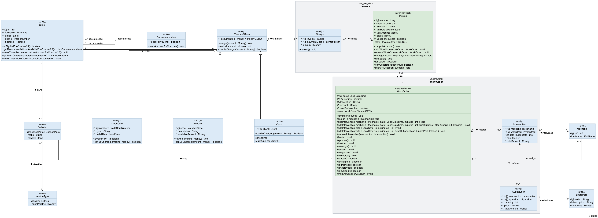

# Proyecto Repositorios de información - JPA

Se maneja la gestión de un taller de coches.

# Práctia 1

− Implementar en Java un modelo de dominio expresado mediante un diagrama de clases
UML
− Añadir funcionalidad a las clases de entidad

